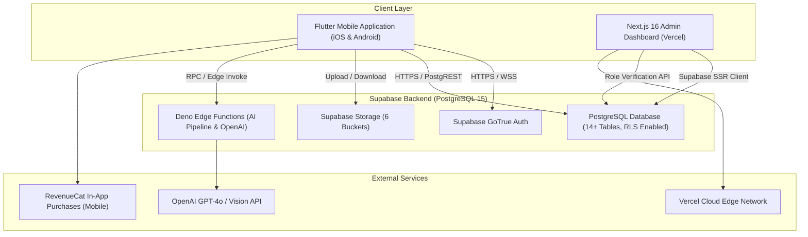
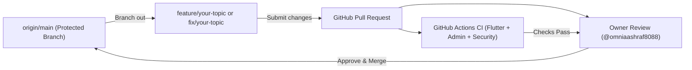

# ANSHIILY (أنشئلي) — External Collaborator & Code Review Guide

Welcome to the **ANSHIILY** project repository! This document serves as the official technical onboarding guide and review handbook for external collaborators and senior code reviewers (specifically **@heshamghareeb**).

---

## 1. Project Overview & Architecture

**ANSHIILY (أنشئلي)** is an AI-powered graphic design and content generation platform designed specifically for the MENA region and international markets, offering first-class native Arabic (RTL) and English (LTR) experiences.



### Key Technical Stack
- **Mobile Framework**: Flutter 3.24+ / Dart 3.x
- **State Management**: Flutter Provider / ChangeNotifier Architecture
- **Admin Dashboard**: Next.js 16 (App Router), React 19, TypeScript, Tailwind CSS v4, Lucide Icons
- **Admin Deployment**: Hosted on Vercel at [https://anshiily-admin.vercel.app](https://anshiily-admin.vercel.app)
- **Backend Infrastructure**: Supabase (PostgreSQL 15, PostgREST, GoTrue Auth, Realtime, Deno Edge Functions)
- **Database Security**: Strict PostgreSQL Row Level Security (RLS) on all public tables with RBAC roles (`user`, `pro_user`, `admin`, `super_admin`)

---

## 2. Repository Directory Structure

```
ANSHIILY/
├── .github/
│   ├── workflows/
│   │   └── ci.yml                     # Automated CI/CD (Flutter & Next.js quality checks)
│   └── pull_request_template.md       # Mandatory PR template
├── admin/                             # Next.js 16 Online Admin Dashboard
│   ├── src/
│   │   ├── app/                       # App Router (/login, /, /api/admin/verify-role)
│   │   ├── components/                # Modular Dashboard components
│   │   ├── lib/                       # Supabase SSR client & AdminContext
│   │   └── types/                     # TypeScript schema definitions
│   ├── eslint.config.mjs              # ESLint 9 configuration
│   ├── next.config.ts                 # Next.js 16 config
│   ├── package.json                   # Admin dependencies
│   └── tsconfig.json                  # TypeScript compiler settings
├── android/                           # Native Android Gradle configuration
├── ios/                               # Native iOS Xcode workspace & Podfile
├── assets/                            # Brand assets, fonts (Cairo, Tajawal, Poppins) & icons
├── lib/                               # Flutter core codebase
│   ├── core/                          # Theme, localization, constants, networking
│   ├── features/                      # Feature modules (auth, editor, export, subscription, etc.)
│   ├── models/                        # Domain data models & JSONB serializers
│   ├── providers/                     # Application state controllers
│   ├── services/                      # Supabase, AI, storage, and export services
│   └── main.dart                      # Flutter application entrypoint
├── supabase/                          # Backend migrations & Edge Functions
│   ├── migrations/                    # Sequential SQL migrations (Phases 2, 4, 6, 7)
│   └── functions/                     # Supabase Deno Edge Functions
├── test/                              # Unit & integration test suites
├── COLLABORATOR_GUIDE.md              # This handbook
└── pubspec.yaml                       # Flutter dependencies & metadata
```

---

## 3. Completed Development Phases (Phase 1 – Phase 7)

Collaborators are requested to audit the real source code across the completed phases:

| Phase | Title | Key Components & Files to Inspect |
| :--- | :--- | :--- |
| **Phase 1** | Foundation & Identity | Brand identity, typography (`assets/fonts/`), theme system (`lib/core/theme/`), RTL/LTR localization. |
| **Phase 2** | Backend & Security | Supabase setup, authentication (`lib/features/auth/`), database tables, initial migrations (`supabase/migrations/`). |
| **Phase 3** | Home, Categories & Library | Categories grid, template browsing, recent projects library (`lib/features/home/`, `lib/features/library/`). |
| **Phase 4** | AI Design Engine | 5-step prompt generation wizard (`lib/features/ai_generator/`), layered JSON document model (`lib/models/design_document.dart`), Edge Function invocation. |
| **Phase 5** | Design Editor & Canvas | Interactive multi-layer canvas, transform tools, typography controls, layer reordering (`lib/features/editor/`). |
| **Phase 6** | Export Engine & Subscriptions | High-res PNG/JPG & PDF export engine (`lib/features/export/`), Subscription paywall & RevenueCat client (`lib/features/subscription/`). |
| **Phase 7** | Admin Dashboard & Hardening | Next.js 16 Admin Dashboard (`admin/`), Vercel deployment, role-based access (`public.is_admin()`), audit logging (`system_audit_logs`), removal of silent SQL error traps. |

---

## 4. Local Setup & Execution Instructions

### A. Flutter Mobile Application

#### Prerequisites
- Flutter SDK 3.24.0 or higher
- Dart SDK 3.5.0 or higher
- Android Studio / Xcode with active simulator or emulator

#### Installation & Execution
```bash
# 1. Fetch dependencies
flutter pub get

# 2. Check environment & formatting
dart format --output=none --set-exit-if-changed lib/ test/
flutter analyze

# 3. Run unit and integration tests
flutter test

# 4. Launch on connected device or emulator
flutter run
```

### B. Next.js 16 Admin Dashboard

#### Prerequisites
- Node.js 20.x or higher
- npm 10.x or higher

#### Installation & Local Execution
```bash
# 1. Navigate to admin directory
cd admin

# 2. Install dependencies
npm ci

# 3. Create .env.local file with public credentials
cat <<EOF > .env.local
NEXT_PUBLIC_SUPABASE_URL=https://wwfhoogtnwyavyvuabbw.supabase.co
NEXT_PUBLIC_SUPABASE_ANON_KEY=sb_publishable_uJ2Mq_atmAoIjHuotMi1-A_AxNmxMD3
EOF

# 4. Run ESLint code inspection
npm run lint

# 5. Build for production (Turbopack)
npm run build

# 6. Start local development server
npm run dev
# The admin interface will be available at http://localhost:3000
```

---

## 5. Supabase Development & Migration Rules

1. **Production Project**:
   - Project ID: `wwfhoogtnwyavyvuabbw`
   - Public API URL: `https://wwfhoogtnwyavyvuabbw.supabase.co`
2. **Never Directly Mutate Remote Production Schema**:
   - Schema modifications must be written as declarative SQL migration scripts in `supabase/migrations/` and submitted via Pull Request.
3. **No Silent Error Traps**:
   - Strict ban on `EXCEPTION WHEN OTHERS THEN NULL;` blocks. Any database function or trigger must fail loudly or log specific error messages.
4. **RLS is Mandatory**:
   - Every created or updated table in `public` schema must have `ALTER TABLE ... ENABLE ROW LEVEL SECURITY;` along with appropriate `SELECT`, `INSERT`, `UPDATE`, and `DELETE` policies.
5. **No Production Secrets**:
   - Never place `service_role` keys, OpenAI secret keys, or payment private keys in client code or Git repository.

---

## 6. Git Branching & Pull Request Workflow

All external collaborator contributions must adhere to the following workflow:



### Branch Naming Conventions
- `feature/<short-description>`: New non-breaking enhancements.
- `fix/<issue-name>`: Bug fixes and security patches.
- `refactor/<module>`: Structural code improvements without behavioral changes.
- `docs/<topic>`: Documentation updates.

### Pull Request Rules
1. Never push directly to `main` (branch protection is actively configured).
2. Open a Pull Request pointing to `main`.
3. Complete all sections of `.github/pull_request_template.md`.
4. Ensure all automated CI checks pass (`Flutter Quality`, `Next.js Admin Build`, `Security Audit`).
5. Await code review and merge approval from the project owner (`@omniaashraf8088`).

---

## 7. Structured Code Review Checklist for Hesham Ghareeb

Please use this checklist when conducting your architecture and source code review:

### Phase 1: Brand & Foundation
- [ ] Inspect `lib/core/theme/` and `lib/core/constants/` for typography and color palette consistency.
- [ ] Verify RTL behavior in Arabic locale and LTR in English locale.

### Phase 2: Supabase Integration & Auth
- [ ] Verify `lib/features/auth/` and `lib/services/supabase_service.dart`.
- [ ] Audit RLS policies in `supabase/migrations/` to ensure users can only access their own private records.

### Phase 3: Home & Design Library
- [ ] Review `lib/features/home/` and `lib/features/library/` models and providers.
- [ ] Inspect caching and pagination strategies for templates and recent projects.

### Phase 4: AI Generation Engine
- [ ] Inspect `lib/models/design_document.dart` and `lib/features/ai_generator/`.
- [ ] Review serialization of multi-layer documents (`elements`, `fonts`, `positions`, `colors`).
- [ ] Ensure Edge Function calls handle timeouts and connectivity failures gracefully.

### Phase 5: Design Editor
- [ ] Inspect `lib/features/editor/` canvas rendering, gesture detection, and matrix transformation calculations.
- [ ] Verify element selection, layer reordering (bring forward / send backward), and undo/redo stacks.

### Phase 6: Export Engine & Subscriptions
- [ ] Review `lib/features/export/` for high-resolution offscreen canvas rendering (`300 DPI`).
- [ ] Audit PDF generation pipeline and temporary file cleanup.
- [ ] Inspect subscription tier checks to ensure Pro features cannot be bypassed on the client.

### Phase 7: Online Admin Dashboard & Vercel
- [ ] Review Next.js 16 codebase under `admin/src/app/` and `admin/src/components/`.
- [ ] Test the live deployment at [https://anshiily-admin.vercel.app](https://anshiily-admin.vercel.app).
- [ ] Verify role authorization API (`/api/admin/verify-role`).
- [ ] Verify `public.system_audit_logs` auditing trigger for critical updates.

---

## 8. Security & Compliance Rules

1. **Account Integrity**: Collaborator must authenticate using his own GitHub account (`@heshamghareeb`). Do not share credentials.
2. **Access Level**: Collaborator has `WRITE` (collaborator) access to propose branches and PRs; repository administration is reserved for `@omniaashraf8088`.
3. **No Direct Production Database Writes**: Database changes must be submitted as migrations in PRs.

For any questions or clarification during review, please open a GitHub Issue or submit a Pull Request discussion.
