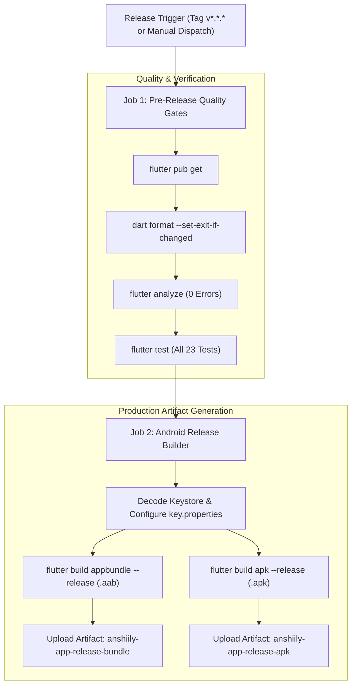

# ANSHIILY Production Release Pipeline
### خطة وتوثيق خط البناء والنشر الآلي للإنتاج

**Application:** ANSHIILY (أنشئلي)  
**Repository:** `omniaashraf8088/ANSHIILY`  
**CI/CD Engine:** GitHub Actions  

---

## 1. Pipeline Architecture



---

## 2. Triggering a Production Release

### Method A: Manual Trigger via GitHub Actions UI
1. Navigate to **Actions > ANSHIILY Production Release Pipeline**.
2. Click **Run workflow**.
3. Specify release tag (e.g. `v1.0.0`).
4. Click **Run workflow** (Requires repository write/admin permission).

### Method B: Git Tag Release
Pushing an annotated Git tag matching `v*.*.*` automatically triggers the release workflow:
```bash
git tag -a v1.0.0 -m "Release v1.0.0: Initial Production Launch"
git push origin v1.0.0
```

---

## 3. GitHub Secrets Configuration for Production Signing

To enable automated cryptographic signing of App Bundles in GitHub Actions, configure the following repository secrets under **Settings > Secrets and variables > Actions**:

| Secret Name | Description | Format / Example |
|---|---|---|
| `ANDROID_KEYSTORE_BASE64` | Base64-encoded release `.jks` file | `base64 -i anshiily-release-key.jks \| pbcopy` |
| `ANDROID_KEYSTORE_PASSWORD` | Master password for the keystore file | String |
| `ANDROID_KEY_ALIAS` | Key alias name defined when creating key | `anshiily` |
| `ANDROID_KEY_PASSWORD` | Password for the specific key alias | String |

---

## 4. Security & Safety Rules

1. **No Production Credentials Committed**: Never store `.jks`, `.keystore`, or plain passwords in Git.
2. **Pull Request Isolation**: The release workflow is restricted strictly to manual dispatch or protected release tags; it cannot be triggered by arbitrary pull requests.
3. **Artifact Retention**: Generated `.aab` and `.apk` artifacts are archived securely for 14 days for direct download and store upload.
