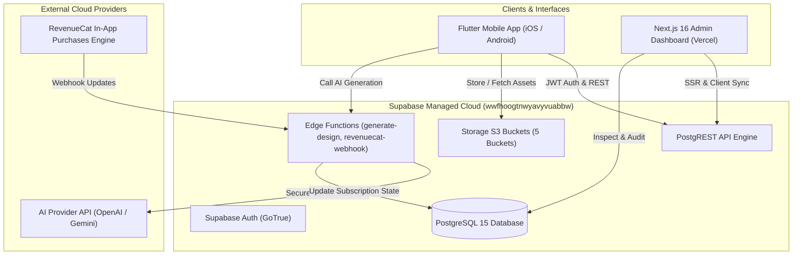

# ANSHIILY Admin Architecture

## System Diagram

## Security & Decoupled Architecture
1. **Server-Side AI Secrets:**
   - The Flutter mobile application never stores any OpenAI or AI model secret key.
   - All AI requests trigger the Supabase Edge Function `generate-design` via bearer JWT.
   - The server parses the prompt, generates the multi-layered document format, and stores it in `designs` & `ai_generation_logs`.
2. **Unified Data Layer:**
   - Both Flutter and Next.js connect to the single authoritative Supabase project `wwfhoogtnwyavyvuabbw`.
   - Edits made in the Admin Dashboard (e.g. creating a new category or updating credits) are instantly reflected in the Flutter app.

